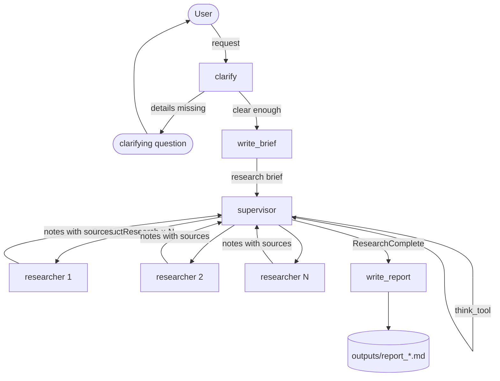

# Deep Research Agent

A multi-agent deep research system built from scratch with [LangGraph](https://github.com/langchain-ai/langgraph).
Give it a question: it clarifies the scope, splits the work into topics, researches each topic on the web **in parallel**, and writes a Markdown report with numbered citations.


## Demo

Abridged transcript of a real run (35 s end to end, three researchers running concurrently):

```text
User: Compare the education systems of Finland, Japan and Chile: academic results and teacher training
AI:   Starting research on comparing the education systems of Finland, Japan, and Chile,
      focusing on academic results and teacher training.

BRIEF:
I want to conduct a detailed comparison of the education systems in Finland, Japan, and Chile,
focusing specifically on academic results and teacher training. […]

🔎 Researching (this takes a few minutes)...

--- Round 1: the supervisor requests ['ConductResearch', 'ConductResearch', 'ConductResearch']
    Launching 3 researchers in parallel...
    ✓ A detailed analysis of Finland's education system focusing on academic results and teacher training […]
    ✓ A detailed analysis of Japan's education system […]
    ✓ A detailed analysis of Chile's education system […]
    (24 s)

--- Round 2: the supervisor requests ['think_tool']
    💭 The notes provided cover the education systems of Finland, Japan, and Chile, focusing on […]

--- Round 3: the supervisor requests ['ResearchComplete']
    Done: the supervisor declared the research complete

📝 Writing the report...
💾 Report saved to outputs/report_2026-10-16_1601.md  (35 s total)
```

The resulting report is in [`examples/report_education_finland_japan_chile.md`](examples/report_education_finland_japan_chile.md).

## How it works



| Phase | File | What it does |
|---|---|---|
| **1. Scoping** | `agent/scope.py` | A small graph that decides, with structured output, whether the request needs a clarifying question (only if the topic, place or goal is missing). Otherwise it rewrites the conversation into a detailed *research brief*. Multi-turn via an in-memory checkpointer. |
| **2. Researcher** | `agent/researcher.py` | A ReAct-style agent with two tools: `search` (DuckDuckGo via `ddgs`) and `think_tool` (a forced reflection step between searches). A hard turn limit guarantees termination. A final `compress` node turns the raw search results into clean notes with `[n]` citations and a *Sources* list. |
| **3. Supervisor** | `agent/deep_research.py` | A supervisor LLM that never researches itself: it fills in "forms" (`ConductResearch`, `ResearchComplete`, `think_tool`). `supervisor_tools` reads those forms, launches one researcher per topic with `asyncio.gather`, and hands the notes back as `ToolMessage`s so the supervisor can check coverage and decide whether to delegate more or stop. |
| **4. Report** | `agent/deep_research.py` | `write_report` synthesizes all notes into a Markdown report that answers the brief, cites sources inline and lists them at the end. |

The agent replies in the language of your request (English request → English report, Spanish → Spanish).

## Quickstart

Requirements: Python 3.12+, [uv](https://docs.astral.sh/uv/), and an [OpenRouter](https://openrouter.ai) API key.

```bash
git clone https://github.com/<you>/deep-research-agent.git
cd deep-research-agent
uv sync

cp .env.example .env        # then put your OPENROUTER_API_KEY in .env
uv run python agent/deep_research.py
```

Type your request at the `User:` prompt. If the agent asks a clarifying question, answer it; type `exit` to quit. Reports are written to `outputs/`.

Each phase also runs on its own, which is handy while tuning prompts:

```bash
uv run python agent/scope.py        # conversation → brief
uv run python agent/researcher.py   # one topic → notes with sources
```

## Project structure

```text
deep-research-agent/
├── agent/
│   ├── scope.py            # Phase 1: clarify + write_brief
│   ├── researcher.py       # Phase 2: research ⇄ tools → compress
│   └── deep_research.py    # Phases 3–4: supervisor loop, write_report, main()
├── examples/
│   └── report_education_finland_japan_chile.md
├── .env.example
├── pyproject.toml
└── uv.lock
```

## Configuration

| Setting | Where | Default | Effect |
|---|---|---|---|
| `OPENROUTER_API_KEY` | `.env` | — | Required. All model calls go through OpenRouter. |
| Model | `ChatOpenAI(model=...)` in each file | `openai/gpt-4o` | Any OpenRouter model id. |
| `MAX_ROUNDS` | `deep_research.py` | `6` | Supervisor calls at most; reflection rounds count. |
| `MAX_RESEARCHERS` | `deep_research.py` | `3` | Topics per round (stated to the model in the prompt). |
| `MAX_TURNS` | `researcher.py` | `10` | Model calls per researcher; on the last one it must answer without tools. |
| `max_results` | `search` in `researcher.py` | `3` | Search results per query. |

## Design notes

- **Two brakes on every loop.** Prompts state soft limits ("2–3 searches for simple questions"); code enforces hard ones (`MAX_TURNS`, `MAX_ROUNDS`). The prompt guides, the code guarantees.
- **Context compression at every hand-off.** Researchers return compressed notes, not their full history (in practice ~15× smaller), so the supervisor's context stays small even with several topics.
- **Tools as forms.** The supervisor's tools are plain Pydantic classes with no code behind them. The LLM fills them in; `supervisor_tools` decides what to do with each one. That is what makes delegation and parallelism explicit.
- **Forced reflection.** `think_tool` does nothing but record text. Its value is that the model has to write down what it found and what is missing before acting again, and then reads it back.
- **Prompt wording is load-bearing.** Small changes alter cost: one phrasing of the supervisor prompt produced 9 topics (one per aspect × country) instead of 3; another made the model answer in the wrong language. Both are documented in the prompts as they are now.

## Limitations

- Researchers read search snippets, not full pages, so depth depends on what the search engine returns. DuckDuckGo may rate-limit concurrent queries; failed searches are reported to the model, not retried.
- The scoping model occasionally asks a question for a request that was already clear, or lets through one that was not.
- No persistence beyond a single run (in-memory checkpointer), no retries, no evaluation harness.
- Only web search is supported; local documents and RAG are out of scope.
- A full run makes roughly 10–20 model calls; keep an eye on cost with larger limits.

## Acknowledgements

The architecture follows LangChain's [`deep_research_from_scratch`](https://github.com/langchain-ai/deep_research_from_scratch) tutorial, rebuilt step by step as a learning project. Models are served by [OpenRouter](https://openrouter.ai); web search by [ddgs](https://github.com/deedy5/ddgs).

## License

[MIT](LICENSE)
